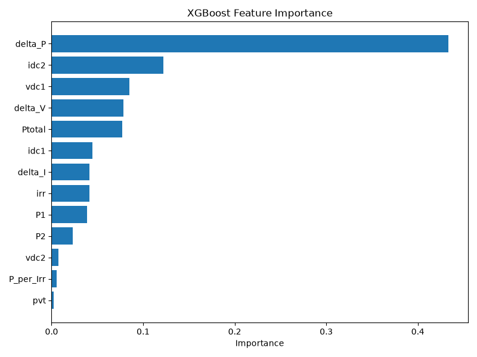
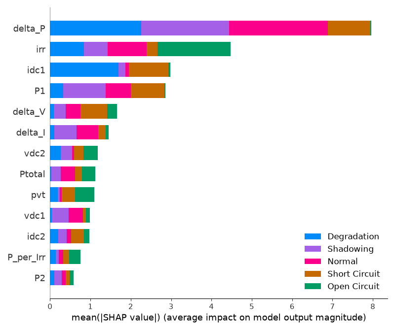

# Solar PV Fault Detection

Machine-learning fault diagnosis for photovoltaic (PV) systems, built end to end: data validation, feature engineering, model selection, explainability, a FastAPI inference service, and a deployed React web app with authentication and a realtime prediction history.

**Live demo:** https://aurum-pv.web.app
**API docs:** https://solar-pv-fault-detection.onrender.com/docs

> The API runs on a free Render instance that sleeps when idle. The first request after a quiet period can take about 50 seconds; after that it responds normally.

---

## What it does

Given six sensor readings from a two-string PV system, the model identifies the operating condition and returns a confidence score for each of five classes.

| Class | Meaning |
|---|---|
| Normal | Voltage and current match the sunlight and temperature |
| Short Circuit | A low-resistance path unbalances one string against the other |
| Degradation | Added resistance quietly reduces a string's power |
| Open Circuit | A string's circuit is broken: current stops while voltage keeps reading |
| Shadowing | Part of the array is shaded, so power drops unevenly |

**Inputs:** `vdc1`, `vdc2` (string voltages), `idc1`, `idc2` (string currents), `irr` (irradiance), `pvt` (panel temperature).

---

## Results

Evaluated once on a stratified 20% hold-out set (274,760 readings) that was never used for training or tuning.

| Metric | Value |
|---|---|
| Final test Macro-F1 | **0.9980** |
| 5-fold cross-validation Macro-F1 (XGBoost) | 0.9982 ± 0.0002 |
| Train vs validation gap | about 0.002 (no overfitting) |
| Baseline (Logistic Regression) Macro-F1 | 0.9307 |

Model comparison on the same split:

| Model | Macro-F1 |
|---|---|
| **XGBoost (tuned)** | **0.9980** |
| Random Forest | 0.9976 |
| Decision Tree | 0.9967 |
| Gradient Boosting | 0.9946 |
| KNN (stratified subsample) | 0.9921 |
| SVM (stratified subsample) | 0.9802 |
| Logistic Regression (baseline) | 0.9307 |

Macro-F1 was chosen as the main metric because the classes are heavily imbalanced (Normal is 84.65% of the data; Short Circuit and Open Circuit are 0.44% each).

The main remaining confusion is between Normal and Shadowing (80 Normal predicted as Shadowing, 109 Shadowing predicted as Normal), most visible at very low irradiance.

### Explainability

SHAP and XGBoost feature importance show that the electrical imbalance between the two strings drives most decisions: `delta_P` is the dominant feature (importance 0.433), followed by `idc2`, `vdc1`, `delta_V` and `Ptotal`. Temperature and the normalised power ratio contribute very little.




### An honest note on the numbers

The dataset comes from a controlled testbed where faults were introduced deliberately, which makes them more separable than faults on a real, noisy plant. Results on a different installation, with different sensors and conditions, may be lower. This is a limitation of the data, not something the model has been tested against.

---

## Dataset

Lazzaretti et al., 2020, *Sensors*. Two MATLAB files (`dataset_elec.mat`, `dataset_amb.mat`) combined into 1,373,798 time-aligned observations with six raw features and a fault label. There are no missing, infinite or duplicate values.

The `.mat` files are not stored in this repository (they are git-ignored). To reproduce the pipeline, place them in `dataset/raw/`.

---

## ML pipeline

| Phase | What was done |
|---|---|
| Data loading and validation | Unified DataFrame, checks for missing, infinite and duplicate values, outlier review |
| EDA | Class distribution, boxplots, correlations, voltage-current and irradiance-power relationships |
| Feature engineering | Seven derived features: `P1`, `P2`, `Ptotal`, `delta_V`, `delta_I`, `delta_P`, `P_per_Irr` |
| Split and preprocessing | Stratified 80/20 split with a fixed random state; scaler fitted on training data only |
| Imbalance handling | SMOTE (training data only) evaluated; the final model did not need it |
| Models | Logistic Regression, Decision Tree, Random Forest, Gradient Boosting, XGBoost, KNN, SVM |
| Validation | 5-fold stratified cross-validation with train scores, to check for overfitting |
| Tuning | RandomizedSearchCV (15 iterations, 3-fold) on XGBoost |
| Final evaluation | One evaluation on the untouched test set |
| Explainability | XGBoost importance and SHAP (TreeExplainer) |
| Packaging | A single scikit-learn Pipeline (feature engineering plus tuned XGBoost) saved as `models/pv_fault_pipeline.pkl`, taking the six raw readings directly |

Tuned XGBoost parameters: `n_estimators=300`, `max_depth=6`, `learning_rate=0.05`, `subsample=0.8`, `colsample_bytree=0.8`.

---

## Web application

```
React (Firebase Hosting)  ──►  FastAPI + ML pipeline (Render)
        │
        └──►  Firebase Auth + Firestore (users and prediction history)
```

- **Landing page** with an animated live diagnosis preview.
- **Authentication** with email/password and Google sign-in (Firebase Auth), plus protected routes.
- **Dashboard:** enter six readings (or load a sample for each condition), get the predicted condition with per-class probabilities, and every diagnosis is saved to the signed-in user's history.
- **Realtime history:** a Firestore listener updates the "condition over time" chart and table instantly.

### API

`GET /health` returns `{"status": "ok"}`.

`POST /predict`

```json
{ "vdc1": 35.2749, "vdc2": 42.9735, "idc1": 0.1155, "idc2": 0.0436, "irr": 1.7059, "pvt": 15.2109 }
```

```json
{
  "predicted_class": 0,
  "predicted_label": "Normal",
  "confidence": 1.0,
  "probabilities": { "Normal": 1.0, "Short Circuit": 0.0, "Degradation": 0.0, "Open Circuit": 0.0, "Shadowing": 0.0 }
}
```

---

## Tech stack

| Area | Tools |
|---|---|
| ML | Python, pandas, NumPy, scikit-learn, XGBoost, imbalanced-learn, SHAP, joblib |
| Backend | FastAPI, Uvicorn, Pydantic |
| Frontend | React, Vite, React Router, Recharts |
| Auth and database | Firebase Authentication, Cloud Firestore |
| Hosting | Firebase Hosting (frontend), Render (backend) |
| Tooling | uv, Jupyter, Git |

---

## Project structure

```
solar-pv-fault-detection/
├── api/                    FastAPI inference service
│   ├── main.py
│   └── requirements.txt    Pinned runtime dependencies for deployment
├── frontend/               React app (Vite)
│   └── src/
│       ├── pages/          Landing, Login, Dashboard
│       ├── components/     Logo, ProtectedRoute
│       ├── context/        AuthContext
│       ├── hooks/          useHistory (Firestore), useReveal
│       └── firebase.js
├── src/                    ML code (loading, features, training, evaluation, SHAP)
├── notebooks/              eda.ipynb
├── models/                 Saved pipeline (pv_fault_pipeline.pkl)
├── reports/                Figures and result tables
├── dataset/                raw/ (git-ignored) and processed/
├── pyproject.toml
└── uv.lock
```

---

## Live app

**https://aurum-pv.web.app**

---

## Author

Aditya Prakash ([@Aprakash-ai](https://github.com/Aprakash-ai))